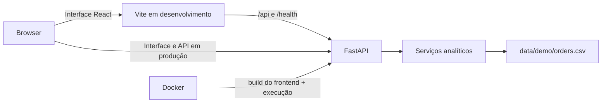

# DataClyra — Analytics Platform

O DataClyra é uma plataforma web de analytics para explorar indicadores comerciais e operacionais a partir de um conjunto demonstrativo. Ela reúne visualizações, filtros, governança de dados e recursos de apoio à análise em uma experiência responsiva.

## Visão geral

O projeto demonstra como disponibilizar métricas de negócio com regras de cálculo explícitas, filtros consistentes e escopo regional por perfil Demo. Destina-se a cenários de demonstração, portfólio e aprendizado em engenharia de dados e desenvolvimento de produtos analíticos.

Entre seus objetivos estão facilitar a leitura de indicadores, tornar visíveis a qualidade e a linhagem dos dados e oferecer uma navegação adequada para desktop e dispositivos móveis. O ambiente atual é autocontido: não depende de serviços de nuvem nem de fontes externas para funcionar.

## Funcionalidades

- Painéis de visão geral, comercial e operacional com KPIs, séries temporais e visualizações por dimensão.
- Filtros globais por período, região, canal e categoria; as comparações usam uma janela anterior de mesma duração quando há base válida.
- Exportação dos registros do recorte ativo em CSV.
- Consulta pontual de pedido pelo identificador.
- Catálogo de dados com campos e definições de métricas.
- Página de linhagem, da fonte demonstrativa até os recursos do portal.
- Central de Qualidade dos Dados para perfis técnicos, com verificações por regra.
- Status técnico do sistema para perfis técnicos.
- Insights automatizados baseados no recorte selecionado.
- Assistente IA demonstrativo com respostas determinísticas, respeitando os filtros ativos.
- Sessão Demo com perfis e escopo regional.
- Interface com tema claro/escuro, menu lateral expansível em telas pequenas e acesso flutuante ao assistente.

## Tecnologias

| Camada | Tecnologias |
| --- | --- |
| Frontend | React 19, TypeScript, Vite, Recharts e Lucide React |
| Backend | Python 3, FastAPI, Pydantic e Uvicorn |
| Dados | CSV demonstrativo local |
| Empacotamento | Docker com build multiestágio |
| Qualidade | ESLint, TypeScript e `unittest` da biblioteca padrão |

## Arquitetura

Em desenvolvimento, o Vite executa o frontend e encaminha `/api` e `/health` para o FastAPI. Em produção, o Docker gera os arquivos estáticos do frontend; o FastAPI entrega a aplicação compilada e também atende às rotas de API. As consultas analíticas carregam sob demanda o arquivo `data/demo/orders.csv` e aplicam o escopo da sessão Demo antes de retornar resultados.



O contrato de dados, as fórmulas e os detalhes das respostas estão em [docs/analytics-data-contract.md](docs/analytics-data-contract.md). A documentação de linhagem complementar está em [docs/data-lineage.md](docs/data-lineage.md).

## Executar localmente

### Pré-requisitos

- Git
- Node.js compatível com o Vite (o projeto declara suporte a Node.js 20.19+ ou 22.12+) e npm
- Python 3.12 ou compatível
- Docker, opcionalmente, para executar o serviço empacotado

### Clonar o repositório

```powershell
git clone https://github.com/tonymiguelsilva/projeto-portal-analytics.git
Set-Location projeto-portal-analytics
```

### Backend para desenvolvimento

Em um terminal, na raiz do repositório:

```powershell
python -m venv .venv
.\.venv\Scripts\Activate.ps1
python -m pip install -r backend\requirements.txt
Set-Location backend
python -m uvicorn app.main:app --reload
```

O backend estará disponível em `http://localhost:8000`.

As variáveis do backend ficam no `.env` da raiz do repositório; use [`.env.example`](.env.example) como referência caso precise alterar os valores padrão `DATA_SOURCE=demo` e `ENVIRONMENT=dev`.

### Frontend para desenvolvimento

Em outro terminal, na raiz do repositório:

```powershell
Set-Location frontend
npm ci
Copy-Item .env.example .env
npm run dev
```

O arquivo copiado para o frontend é `frontend/.env.example`: ele define `VITE_API_BASE_URL=http://localhost:8000`, endereço compatível com o proxy configurado no Vite para `/api` e `/health`. O `.env` da raiz é destinado ao backend. O Vite exibirá no terminal o endereço da interface, normalmente `http://localhost:5173`.

Para verificar a aplicação, selecione um perfil Demo na tela inicial e navegue pelos painéis. O indicador de conexão consulta `GET /health`.

### Executar com Docker

Na raiz do repositório:

```powershell
docker build -t dataclyra .
docker run --rm -p 10000:10000 dataclyra
```

Abra `http://localhost:10000`. A imagem define `ENVIRONMENT=prod` e `DATA_SOURCE=demo`, compila o frontend e o entrega pelo FastAPI no mesmo serviço.

## API e saúde do serviço

- `GET /health`: retorna o estado básico da API. A resposta esperada é `{"status":"ok","message":"API está funcionando"}`.
- `GET /docs`: documentação interativa gerada pelo FastAPI.
- `GET /openapi.json`: especificação OpenAPI gerada pelo FastAPI.

As rotas analíticas e de sessão Demo são documentadas no OpenAPI e no [contrato analítico](docs/analytics-data-contract.md). As rotas analíticas exigem uma sessão Demo válida; a interface cria e envia essa sessão automaticamente.

## Dados e limitações

- O ambiente usa exclusivamente o conjunto fictício `data/demo/orders.csv`. Ele não contém dados pessoais ou sensíveis.
- Os dados são carregados sob demanda e não há atualização automática, persistência histórica ou integração operacional com warehouse.
- A configuração aceita `DATA_SOURCE=bigquery`, mas essa integração não está implementada e não deve ser usada neste ambiente.
- O assistente é determinístico e demonstrativo: não chama modelos externos nem exige uma API paga.
- A sessão Demo é armazenada em memória, expira e não constitui um mecanismo de autenticação para produção.

## Testes e qualidade

### Frontend

Na pasta `frontend/`:

```powershell
npm run lint
npm run build
```

`lint` executa o ESLint e `build` executa a checagem TypeScript seguida do build do Vite.

### Backend

Com as dependências do backend instaladas, na pasta `backend/`:

```powershell
python -m unittest discover -s tests -v
```

Os testes disponíveis cobrem a API ASGI, sessão Demo, autorização regional, fonte de dados, regras analíticas e configuração. Para verificar espaços em branco do patch Git, use na raiz:

```powershell
git diff --check
```

## Deploy

O projeto está preparado para publicação como um único serviço Docker no Render. O `Dockerfile` instala as dependências do backend, compila o frontend e inicia o Uvicorn em `0.0.0.0` usando a variável `PORT` fornecida pela plataforma (porta `10000` como padrão local).

No serviço Render, configure o repositório com o `Dockerfile` da raiz. Não é necessário configurar uma URL de frontend separada: em produção, o FastAPI serve os arquivos compilados e as rotas da API no mesmo serviço. O ambiente Docker já utiliza `ENVIRONMENT=prod` e `DATA_SOURCE=demo`.

## Estrutura de pastas

```text
projeto_portal_analytics/
├── backend/
│   ├── app/
│   │   ├── api/            # rotas, dependências e segurança Demo
│   │   ├── core/           # configurações
│   │   ├── schemas/        # contratos Pydantic
│   │   └── services/       # fonte e regras analíticas
│   ├── tests/              # testes do backend
│   └── requirements.txt
├── data/demo/orders.csv    # base demonstrativa fictícia
├── docs/                   # contrato e documentação complementar
├── frontend/
│   ├── src/                # aplicação React
│   ├── public/             # recursos estáticos
│   ├── package.json
│   └── vite.config.ts
├── Dockerfile
├── .env.example
└── README.md
```

## Roadmap

- Implementar uma fonte de dados externa somente quando houver contrato, segurança e operação definidos.
- Adicionar uma estratégia de autenticação apropriada antes de qualquer uso com dados reais.
- Ampliar a cobertura de testes de interface e automação de cenários responsivos.

## Licença

Este repositório não possui um arquivo de licença. Até que uma licença seja adicionada, não se deve presumir autorização para redistribuir ou modificar o projeto.
